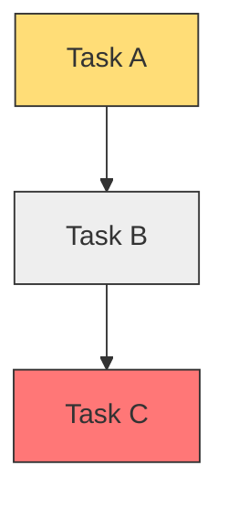
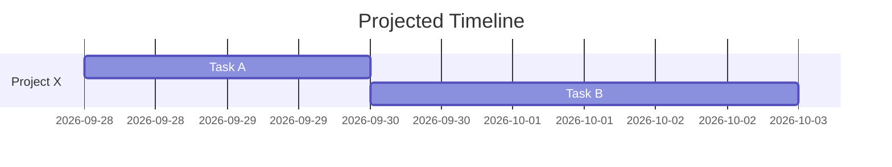

# Visualisation Snippets

## Status Colours

| Status | ASCII | Mermaid Class | Meaning |
|--------|-------|---------------|---------|
| `blocked` | `\e[31m[RED]\e[0m` | `classDef blocked fill:#f77` | Cannot proceed without unblocking |
| `inprogress` | `\e[33m[AMBER]\e[0m` | `classDef inprogress fill:#fd7` | Active work |
| `complete` | `\e[32m[GREEN]\e[0m` | `classDef complete fill:#7f7` | Done |
| `notstarted` | `\e[37m[GREY]\e[0m` | `classDef notstarted fill:#eee` | Not yet started |

## ASCII Tree

```
[Project Name]
├── [GREEN] Complete task
├── [AMBER] In-progress task
│   └── blocked by: some dependency
├── [RED] Blocked task
└── [GREY] Not-started task
```

## Mermaid Dependency Tree



## Mermaid Gantt



## Bash Commands

```bash
# Show the full ASCII tree
bash resources/focus-visualiser.sh

# Show only today's focus list
bash resources/focus-visualiser.sh --today

# Output a Mermaid diagram
bash resources/focus-visualiser.sh --format mermaid
```

## Quick Scoring Formula

```
focus_score = (urgency * importance * impact * confidence) / (effort + 1)
```

Apply the result through the curated lenses:

1. **Eisenhower** — top-right quadrant (urgent + important) gets the highest weight.
2. **RICE/ICE** — multiply by reach/impact/confidence and divide by effort.
3. **Pareto** — the top ~20% of tasks by score are likely to deliver 80% of value.
4. **MoSCoW** — `Must` tasks override `Should`/`Could` regardless of score.
5. **Buffett 5/25** — the top 5 become the daily focus list; the rest are hidden until one is done.
6. **OKR** — tasks linked to a key result get an alignment bonus.
